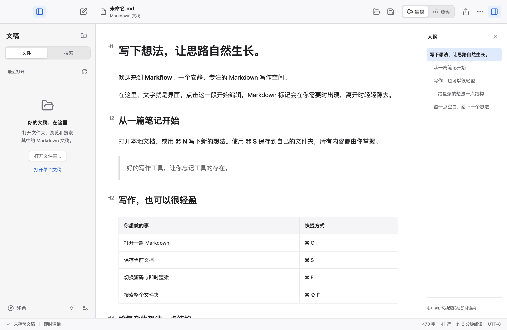

# Markflow

A local-first Markdown editor for macOS, with a document-focused interface, native menus and seamless editing powered by Vditor.



## Download

Download the Apple Silicon application from [Releases](https://github.com/HuiAnnn/markflow/releases), unzip it, and drag **Markflow.app** to Applications.

The current release is a local, ad-hoc-signed build, not Apple-notarized. macOS may ask you to confirm opening it. For source builds, Node.js 22.12 or newer is required.

## Features

- Immediate rendering and Markdown source mode in one editor; headings, tables, KaTeX math and Mermaid diagrams work offline.
- Real file opening, saving and Save As, with unsaved-change prompts and protection against external edits.
- Collapsible folder browser, literal full-text search and source-line navigation.
- macOS native application, appearance and export menus; native file dialogs and window controls.
- System, Light, Dark and Warm Paper appearance; focus mode, typewriter mode and optional autosave.
- Keyboard-accessible settings, sidebar tabs and resizing, responsive inspector, reduced-motion and increased-contrast support.
- Portable HTML with local images embedded, built-in PDF, and optional Pandoc DOCX/PDF export.

The app uses Electron for its native shell and Vditor for editing. The editor and custom layout are web-based; the menu bar, popup menus, file dialogs and window controls are native macOS components.

## Build and run

```sh
npm ci
npm start
npm run build
```

On Apple Silicon, the built app is in `dist/release/mac-arm64/Markflow.app`. `npm run build:dmg` creates a disk image. Builds use the locally installed Electron distribution. Electron may download its runtime on the first launch; run `npx install-electron` if your environment requires explicit installation.

## Keyboard shortcuts

| Action | Shortcut |
| --- | --- |
| New document | ⌘N |
| Open document / folder | ⌘O / ⌘⇧O |
| Save / Save As | ⌘S / ⌘⇧S |
| Toggle source | ⌘E |
| Search folder | ⌘⇧F |
| Settings | ⌘, |
| Toggle outline / sidebar | ⌘⇧1 / ⌘⇧2 |
| Leave focus mode / close settings | Esc |

To make Markflow the default Markdown application, select a `.md` file in Finder, choose **Get Info → Open with → Markflow → Change All**.

## Export

HTML and the built-in PDF engine need no external tools. Word export requires Pandoc. Pandoc PDF also requires an installed LaTeX engine. Use built-in PDF for rendered diagrams and local fonts.

```sh
brew install pandoc
```

Missing tools and conversion errors are reported inside the app. Pandoc conversion depends on the installed engine and filters; it is not bundled.

## Privacy

Documents stay in the local locations you choose. There are no app accounts, telemetry or cloud synchronization. Appearance and editing preferences are stored locally. Remote images explicitly included in a document may contact their source when rendered, and opened external links use the default browser.

Development screenshots and tests use sample documents. Personal documents, credentials, local machine paths, private planning records and runtime logs are excluded from this repository and release.

## Verification

```sh
npm test
npm run test:e2e
```

Filesystem tests use real temporary files. Electron tests exercise real IPC, editor rendering and disk writes; only native dialog choices are substituted. The UI/UX audit and screenshots are in [docs/qa/UI-UX-AUDIT.md](docs/qa/UI-UX-AUDIT.md).

## Current limits

- UTF-8 text only, up to 10 MB per document. Existing UTF-8 BOM, CRLF and file permissions are preserved.
- Folder browsing: up to 5,000 entries and 32 directory levels. Search returns up to 200 matching lines and reports truncation.
- Hidden directories, dependencies and symlinks are excluded from folder traversal. Refresh manually after external changes; saving detects external modifications.
- Autosave is off by default and only writes documents already saved to a disk path, after 1.2 seconds without input.
- Local images can resolve within the opened document's directory or selected workspace. Open the containing workspace to use parent-relative image paths.
- A single document is open at a time; recent documents last for the session.

## License

Application source: MIT. See [THIRD_PARTY_NOTICES.md](THIRD_PARTY_NOTICES.md) for bundled dependency licenses. Markflow is an independent project, not affiliated with Apple or Typora.
